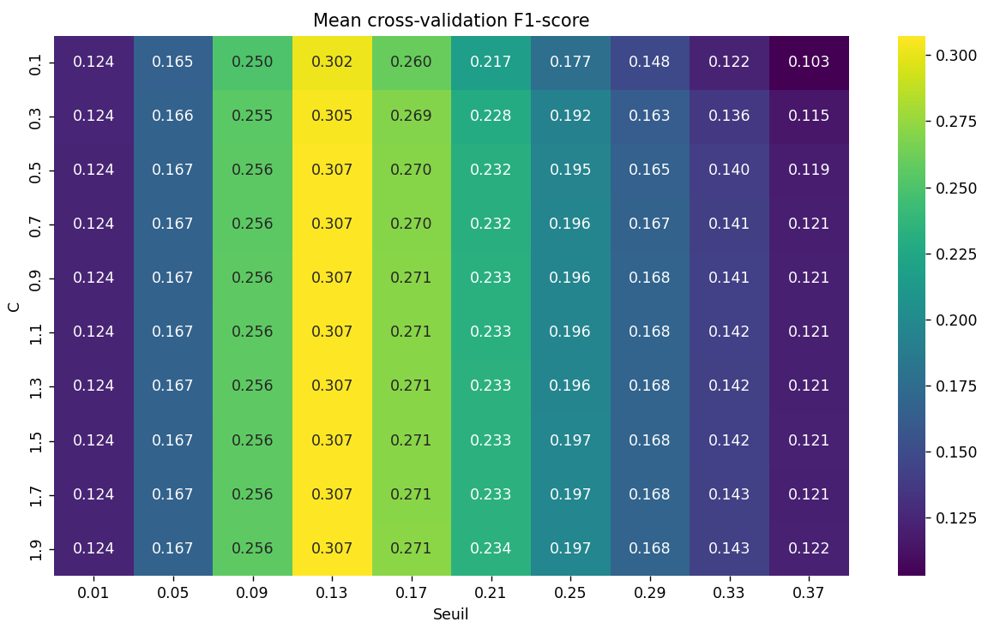

# Part I — Logistic Regression

## Research question

Can a regularized logistic regression model identify individuals at risk of serious credit delinquency, and how does the classification threshold affect performance on an imbalanced dataset?

This is the first model in a comparative machine-learning project. The same **Give Me Some Credit** dataset will be used for Random Forest and neural-network experiments.

## Dataset

- **Source:** [Kaggle — Give Me Some Credit](https://www.kaggle.com/competitions/GiveMeSomeCredit/data)
- **Training dataset:** `cs-training.csv`, approximately 150,000 observations
- **Target:** `SeriousDlqin2yrs` (binary indicator of serious delinquency within two years)
- **Predictors:** 10 numerical credit-history and demographic variables
- **Class imbalance:** roughly 6.7% positive observations
- **Missing data:** 29,731 values in `MonthlyIncome` and 3,924 in `NumberOfDependents`

The dataset is not included here. Download `cs-training.csv` from Kaggle and place it in `data/` at the repository root, or next to `logistic_regression.py`.

## Methodology

1. **Data split:** stratified 80% training / 20% held-out test, using `random_state=42`.
2. **Preprocessing:** median imputation and standardization, both included in a scikit-learn `Pipeline`. Preprocessing is fitted separately within each training fold to avoid leakage.
3. **Model:** logistic regression with L2 regularization (scikit-learn defaults).
4. **Hyperparameter selection:** five-fold stratified cross-validation on the training set. The grid explores 10 values of inverse regularization strength `C` (0.1–1.9) and 10 probability thresholds (0.01–0.37).
5. **Selection criterion:** maximum mean cross-validation F1-score.
6. **Final evaluation:** retrain on the full training set, then assess performance on the held-out test set. A default `C=1`, threshold-0.5 baseline is evaluated on the same test set for comparison.

For computational efficiency, the model is fitted once per `(C, fold)`; each set of predicted probabilities is reused to evaluate every candidate threshold. This requires **50 fits rather than 500**.

## Cross-validation results

- **Selected C:** 1.3
- **Selected decision threshold:** 0.13
- **Mean five-fold validation F1-score:** 0.3073

The F1-score is relatively insensitive to `C` once regularization becomes sufficiently weak, but it is highly sensitive to the classification threshold.



## Held-out test results

| Metric | Baseline (C=1, threshold=0.50) | Tuned model (C=1.3, threshold=0.13) |
| --- | ---: | ---: |
| Accuracy | 0.9340 | 0.9139 |
| Recall | 0.0449 | 0.3162 |
| Precision | 0.5806 | 0.3433 |
| **F1-score** | **0.0833** | **0.3292** |

*These are the results of the author's reported run with the fixed split and cross-validation settings; they have not been independently rerun here.*

## Interpretation

At the default 0.5 threshold, the model achieves high accuracy but identifies only about **4.5%** of actual positive cases. Accuracy is misleading because most borrowers belong to the negative class.

Reducing the threshold to 0.13 increases recall to **31.6%**, at the cost of lower precision and a modest decrease in accuracy. The held-out F1-score increases from **0.0833 to 0.3292**. This demonstrates why threshold selection matters for imbalanced classification.

A threshold that maximizes F1 is **not automatically optimal for real credit decisions**: the relative costs of false positives and false negatives, probability calibration, and operational constraints would need to be considered in a deployment setting.

## Reproduce

Install the dependencies:

```bash
pip install pandas numpy matplotlib seaborn scikit-learn
```

Download `cs-training.csv` from Kaggle, place it in `data/` at the repository root (or beside the script), and run:

```bash
python 01_logistic_regression/logistic_regression.py
```

The script prints missing-value counts, selected hyperparameters, baseline and tuned test metrics, and saves the cross-validation heatmap to `01_logistic_regression/figures/`.

## Limitations and next steps

- A linear log-odds model cannot automatically capture nonlinear relationships and interactions.
- The input data contain outliers and anomalous credit-history values that warrant further investigation.
- The selected threshold is optimized for F1, not an explicit financial loss function.
- Subsequent sections compare this baseline with Random Forest and neural networks using the same dataset.
